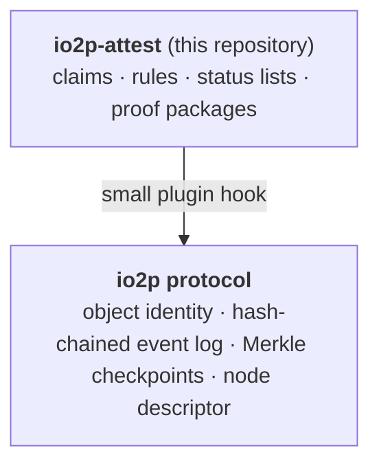
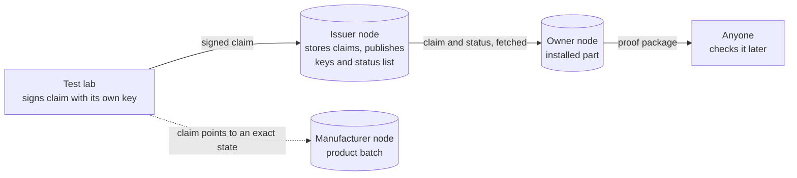

# io2p-attest

Signed, checkable and withdrawable claims about real-world objects, built on the [io2p](https://io2p.org) protocol.

A test lab says a batch of fire doors passed a fire test. A manufacturer says a product contains 30% recycled steel. A contractor says a part was installed in a specific building. Today claims like these travel as PDFs and emails, and three simple questions are hard to answer:

1. Who made this claim, and has it been changed since?
2. Is it about this exact object, or only about something similar?
3. Is it still valid, or has it been withdrawn?

io2p-attest is an open standard and a reference implementation that answers those questions without a central authority. Anyone can check a claim, the same way a browser checks a website's certificate, without asking the issuer about each claim and without trusting a platform in the middle.

## Status

Early design, not ready to use. [`SPEC.md`](SPEC.md) is a rough design outline. It was written before detailed planning; scope, design and details may change during review and development. io2p itself is still being built, and this work will follow how its core develops.

Feedback is welcome, especially from people working on product passports, certification, verifiable credentials or supply chain data. Please open an issue.

## How it fits io2p

io2p is an open, generic protocol that gives any object a globally unique identity and a tamper-evident history. Each organisation runs its own node and keeps its own data there. There is no central registry; each node decides which other nodes it works with.

io2p-attest adds one thing on top: **claims made by one party about an object, that anyone can check.**

It builds on parts of io2p that already exist or are being built in the io2p reference node:

- stable object identities and a hash-chained event log
- the node descriptor, where a node publishes what it is and what it offers
- Merkle checkpoints over the event log

The node needs only a small plugin; everything else lives in this repository.

## Inspired by how the internet works

io2p takes many ideas from the internet itself. Like DNS and the web, it has no single owner: each organisation runs its own node under its own domain, and others find it and decide whether to trust it.

io2p-attest follows the same path for claims, and borrows most from HTTPS certificates:

| HTTPS | io2p-attest |
| --- | --- |
| A certificate authority signs a certificate | A lab or certifier signs a claim with its own key |
| The certificate is for one exact website | The claim is for one exact version of one object |
| Validity dates and revocation lists | Validity dates and signed status lists |
| The site proves who it is through its domain | The issuer publishes its keys on its own domain |
| Certificate Transparency logs show nothing was hidden | The io2p event log and Merkle proofs show the object's history |

It goes further in three places: claims carry conditions that are checked against how the object is used, a withdrawal flags the records that depend on it, and the whole proof fits in one file that can be checked later. And unlike the web, there is no fixed list of trusted authorities: every issuer signs for itself, and every verifier decides whom it trusts.

## Main ideas

**A claim points to an exact state.** A claim is not about "product X" in general. It names the object and the hash of the exact recorded state it covers, so nobody can later say it was about something else.

**Claims are signed by whoever makes them.** The lab, certifier or manufacturer signs with its own key. Keys can be rotated and revoked; a claim signed with a key that was valid at the time stays valid.

**Issuers don't need their own node.** A lab can sign claims on its own machine and publish them through a shared node run by someone else. The node stores them but cannot sign in the lab's name. Running your own node is possible too.

**Conditions are data, not small print.** "Valid for indoor use, for batches made in 2026, until 2029" is written as a small rule that software can check, and every implementation should reach the same answer.

**Withdrawals are published, not pushed.** Issuers publish a signed status list. Nodes and clients fetch it and flag records that depend on a withdrawn claim. There is no central server, which matches how io2p works: data stays at its source.

**Proof you can take with you.** A proof package is a single file with the claim, the relevant object history, the status at that moment, the issuer's keys and the Merkle proofs. Anyone can check it later. Only one step, comparing with the node's current checkpoint, needs the network.

**Claims are not truth.** The system proves who said what and when. It never says that a material is good. Results always read as "issued by X, checked against rules Y".

## What we expect to build

Roughly, and open to change as the design develops:

- the specification, with shared test cases
- a library to create, sign and check claims
- a plugin that adds claims to an io2p node
- a command-line tool to check proof packages
- a small demo that shows the whole flow

## Not in scope

- blockchain anchoring, tokens or any kind of trading
- keys held by individual users; organisations sign, people do not need to manage keys
- AI features

## Contributing

Issues and discussion on the spec are very welcome. Code contributions will open once development starts.

## Use of AI

Code and documentation here are written by people, without generative AI. The first drafts of this README and SPEC had AI help and are being reworked by the team.

## License

MIT. See [LICENSE](LICENSE).
