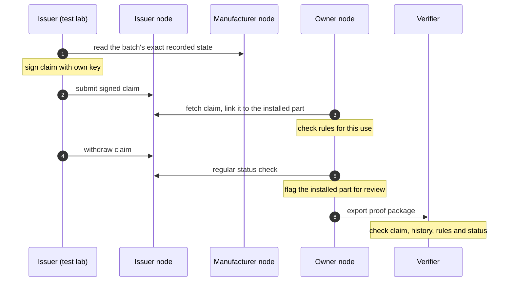

# io2p-attest: design outline

**Draft 0.1, a rough plan for review.**

> This is a first outline of the idea, written before detailed planning and before development has started. It describes the direction, not a final design. Scope, design and structure may all change during review and while the work is done. Exact formats, field names and algorithms will be defined during development. io2p itself is still being built, so this outline will follow how its core develops.

## 1. Purpose

io2p-attest lets one party make a claim about an io2p object, lets anyone check that claim, and lets the issuer withdraw it later. It does not define what a claim *means*: a fire test result, a recycled-content declaration and an installation record are all claims with a type. Domains define their own claim types on top.

## 2. Roles

- **Issuer:** the organisation that makes a claim, for example a test lab. It signs with its own key.
- **Issuer node:** the io2p node where the issuer's claims and status are published. It does not have to be run by the issuer.
- **Subject:** the io2p object a claim is about, at one exact recorded version.
- **Verifier:** anyone who checks a claim: a node, an app, an auditor.

## 3. The claim

A claim says who claims what about which object, and under which conditions. Roughly, it contains:

- the issuer
- the subject: the object's id and the exact version it covers, with a hash of that state
- the claim type and its content, for example a test result
- optionally the standard it refers to, the rules under which it applies, and references to evidence files
- validity dates
- a pointer to where its current status is published

Evidence files (test reports, photos) are referenced by hash, not included. That keeps personal data out of claims, which matters because io2p never deletes data.

A claim covers one exact version of an object. If the object changes, the claim does not move with it automatically.

## 4. Keys and signing

- Claims are signed by the issuing organisation with its own key. Individual users do not need keys.
- Issuers publish their public keys, so anyone can check a signature.
- Keys can be replaced. Normal rotation keeps old claims valid; a key revoked after it was stolen invalidates what was signed with it afterwards.
- Issuers do not need their own node. An issuer can sign claims on its own machine and publish them through a node run by someone else. That node can store the claims but cannot sign in the issuer's name.
- A verifier also needs to know that a key really belongs to the organisation it names. The first idea is that issuers also publish their keys on their own web domain, as websites do.

## 5. Rules

A claim can carry conditions, for example "valid for indoor use, for batches made in 2026, until 2029". These are written as a small set of rules that software can check against how the object is used. The rule format stays deliberately simple so that every implementation reaches the same answer. A check can end as *applies*, *does not apply* or *unknown* when information is missing.

## 6. Status and withdrawal

- Claims expire through their validity dates.
- Issuers can also withdraw or replace a claim early. They publish this in a signed status list that covers many claims at once, so checking it does not reveal which claim someone is interested in.
- Nothing is pushed between nodes, matching how io2p works. Nodes and clients fetch status lists regularly, and a node flags its own records that depend on a changed claim.
- Status information that is too old is not trusted: the answer becomes *unknown* instead of *valid*.

## 7. Claims in io2p

Claims are recorded on io2p nodes as an addition to the existing data model, through a plugin. Existing records do not change, and a node without the plugin works as before.

## 8. Proof packages

A proof package is one file with everything needed to check a claim later: the claim, the relevant object state and its proof in the node's history, the rules, the status at that time and the issuer's keys. It contains only the records needed for that claim. Anyone can check it without access to the systems involved; in this version, one step compares it with the node's current history online.

## 9. Checking a claim

In short, a verifier checks that:

1. the signature is valid and the key belonged to the issuer at that time
2. the claim refers to a real recorded state of the object
3. the claim is within its validity dates
4. the rules apply to this use
5. the claim has not been withdrawn or replaced

The result is always shown with its sources, as "issued by X, checked against rules Y", never as "certified".

## 10. Interoperability

Claims will be exportable to and importable from W3C Verifiable Credentials. Short mapping notes are planned for GS1 identifiers, EPCIS events and Digital Product Passport data.

## 11. Related work

W3C Verifiable Credentials and Bitstring Status List give signed claims and withdrawal; we reuse their ideas. The UN Transparency Protocol (UNTP) defines conformity credentials issued by certifiers, identifying products by id. Software supply chain attestations (in-toto, SLSA, Sigstore) and TradeTrust solve similar problems for software and trade documents.

What this project adds is the combination: claims bound to an exact version of an object with a verifiable history, conditions checked against how the object is used, withdrawal that reaches dependent records, and a single file that proves it.

## 12. Open questions

These will be settled during development:

- the exact format of claims, rules, status lists and proof packages
- whether to use our own small rule format or part of an existing one
- whether one claim can cover several versions of an object
- how a replaced claim points to the new one
- how keys are tied to organisations beyond their own web domain
- how a shared node accepts claims signed elsewhere
- whether proof packages can later be checked fully offline
